# realfans

laptoplar için ince, kompakt ve ergonomik bir fan.
piyasadaki laptop fanları yetersiz, iyisini yapan yok. bu repo o boşluğu doldurma denemesi.

## durum

mimari kurgu, parametrik cad prototipleri (`freecad`) ve datasheet tabanlı hava akışı / termal simülasyon (`sim/`) hazırlandı. kicad şema ve kart aşamasına geçilecek.
iş ilk günden açıkta ilerlesin diye repo şimdiden public.

## hedef

- **ince:** yüksekliği fark ettirmeyen katlanabilir bir gövde (15–17 mm)
- **kompakt:** çantaya giren, taşınabilir
- **ergonomik:** kullanırken rahat, usb-c pd ile tek kablodan çalışan

## yol haritası

- [x] mevcut laptop fanlarını ölç: hava akışı, ses, kalınlık ve statik basınç analizi
- [ ] fan sürücü devresinin şeması (kicad)
- [ ] kart tasarımı
- [x] gövde: parametrik cad (`cad/`), sızdırmaz conta ve radyal blower yerleşimi
- [ ] prototipi ölç, mevcut fanlarla karşılaştır

## klasörler

| dosya / klasör | ne var |
| --- | --- |
| `ana_mantik.md` | mekanik, aerodinamik ve elektronik ana mimari |
| `cad/` | freecad parametrik makroları (`.FCMacro`), `.FCStd` ve `.step` modelleri |
| `sim/` | 2b/3b hava akışı-termal çözücü (`run_airflow_thermal_sim.py`) ve canlı rüzgar tüneli (`canli_ruzgar_tuneli.html`) |
| `realfans.kicad_pro` | kicad 10 projesi |
| `realfans.kicad_sch` | şema (şimdilik boş) |
| `realfans.kicad_pcb` | kart (şimdilik boş) |

## lisans

apache-2.0. bkz. [LICENSE](LICENSE).

---

**in short (english).** realfans is an open hardware project: a thin, compact, ergonomic laptop cooling pad, because the ones on the market fall short.
parametric cad models and datasheet-calibrated thermal/airflow simulations are in `cad/` and `sim/`; the kicad project is set up for the usb-c pwm controller board.
licensed under apache-2.0.
