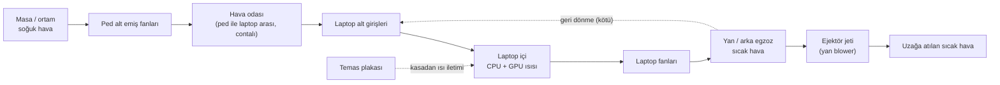

# RealFans — Ana Mantık Haritası (Faz 0: geniş, ferah, kalınlık serbest)

> [!IMPORTANT]
> Bu fazda **kalınlık, maliyet, estetik yok**. Tek soru: *Hangi fiziksel mekanizma laptopu gerçekten soğutuyor, hangisi soğutmuyor?* Kazanan mekanizmalar sonra 15 mm'ye sıkıştırılacak.

---

## 1. Tek cümlede fikir
Laptopun **soğuk hava aldığı yere basınçlı soğuk hava vermek**, **sıcak havanın attığı yerden geri dönmesini engellemek**, gerekirse **kasadan doğrudan ısı çekmek**.

## 2. Havanın yolu

Kesikli oklar: **geri dönme** = egzozun tekrar emilmesi (ped bunu kesmeli). **Temas plakası** = hava değil, iletimle ısı çekme (deneysel).

---

## 3. Mekanizmalar — ne olur, ne olmaz

| # | Mekanizma | Fizik | Beklenti | Güven |
|---|---|---|---|---|
| M1 | **Alt girişlere basınçlı hava** (fan + contalı hava odası) | Laptop fanı daha az zorlanır, daha çok serin hava geçer | **Ana kazanç** burada | Yüksek |
| M2 | **Yan egzoz ejektörü** (egzozun altından aynı yöne jet) | Jet, sıcak havayı sürükleyip uzaklaştırır; geri dönmeyi keser | Orta — masada sıcak hava birikiyorsa belirgin | Orta |
| M3 | **Yön verici kanatçık** (fan çıkışında statör) | Fan girdabını statik basınca çevirir | Küçük–orta, ama parça zaten var → bedava | Orta |
| M4 | **Temas plakası / ısı borusu** | Alt kasadan iletimle ısı çekme | Plastik kasada ~0, alüminyum kasada birkaç °C | Düşük |
| M5 | **Arka egzozlu laptoplar** | M2'nin arka kenara taşınmış hali | Ayrı prototip | — |

### ❌ İşe yaramayanlar (baştan eleyelim)
- **Egzoza karşı üflemek** → laptopun çıkışını tıkar, ısıtır.
- **Alt girişte ejektör / venturi** → debiyi artırır ama basıncı düşürür; laptop girişleri basınç ister.
- **Pasif "türbin" ile bedava basınç** → enerjiyi sadece fan ekler; sabit geometri yalnızca hız⇄basınç çevirir.
- **Contasız fan** → havanın çoğu yanlardan kaçar, laptopa az ulaşır.
- **Peltier (termoelektrik)** → USB-C'nin 15 W'ı yetmez, çektiğinden fazla ısı üretir, yoğuşma riski.

> [!WARNING]
> **Gizli tuzak:** Piyasadaki soğutucuların kazancının önemli kısmı fanlardan değil, laptopu **masadan yükseltmekten** geliyor olabilir. Bu yüzden testte mutlaka "fanlar kapalı, sadece yükseltilmiş" durumu ölçülmeli. Yoksa fanlara haksız kredi veririz.

---

## 4. Proto-0: test tezgahı (çirkin ama dürüst)

Kalınlık serbest, ~40 mm. Amaç ürün değil, **ölçüm**.

| Parça | Seçim | Neden |
|---|---|---|
| Çerçeve | Köpük pano / MDF / 3D baskı | Hızlı kes-yapıştır, değiştirmesi kolay |
| Alt fanlar | 2 × **120×25 mm PC fanı** (PWM) | Ucuz, her yerde var, basınç–debi eğrisi yayınlanmış |
| Hava odası | Üst plaka + çevresinde **köpük conta** | M1'i contalı/contasız kıyaslamak için sökülebilir |
| Yan ejektör | 2 × **5015 blower** + 3D baskı yarık ağız | M2; ağız parçası değiştirilebilir (yarık genişliği, açı) |
| Temas plakası | 2–3 mm alüminyum levha + termal ped | M4; sökülebilir |
| Güç | 12 V adaptör + basit PWM kontrolcü | Faz 0'da USB-C şart değil |

## 5. Nasıl ölçeceğiz

- **Yük:** Cinebench R23 (10 dk döngü) + GPU yükü (3DMark / sabit bir oyun sahnesi), her test 15–20 dk, sonunda kararlı değer.
- **Kayıt:** HWiNFO → CPU/GPU sıcaklığı, **saat hızı**, güç. Oda sıcaklığı termometreyle.
- **Asıl metrik:** `ΔT = T_CPU − T_oda` ve **throttling olup olmadığı** (saat hızı düşüyor mu).
- **Gürültü:** Telefon dB uygulaması, 50 cm'den.
- **Görsel:** Tütsü dumanı → egzozun geri dönüp dönmediğini gözle görürsün (bedava "CFD").

## 6. Test matrisi

| Test | Kurulum | Neyi ayırır |
|---|---|---|
| A | Laptop düz masada | Referans |
| B | Proto üstünde, **fanlar kapalı** | Sadece yükseltmenin etkisi |
| C | Alt fanlar açık, **contasız** | Fanın kendi etkisi |
| D | Alt fanlar açık, **contalı** | M1 — hava odası etkisi |
| E | D + **yan ejektör** | M2 |
| F | D + **kanatçıklı ızgara** | M3 |
| G | D + **temas plakası** | M4 |

Her mekanizmanın etkisi bir önceki testle farktan okunur. CFD aynı A–G senaryolarını paralel çalıştırır; ikisi örtüşürse simülasyona güvenip ince versiyonda daha az fiziksel deneme yaparız.

## 7. Sonrası (Faz 1+)
Kazanan mekanizmalar → 15 mm'ye sıkıştırma → 5 V / USB-C → katlanma ve kilit → kalıplanabilir tasarım.
